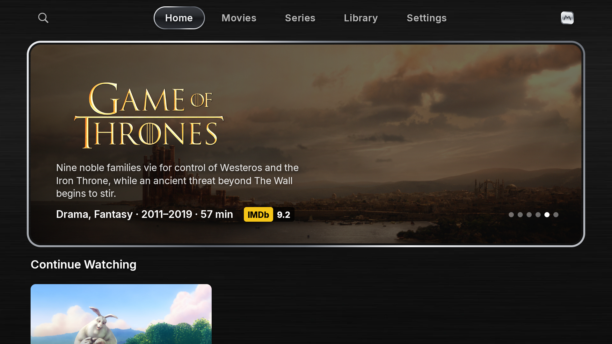
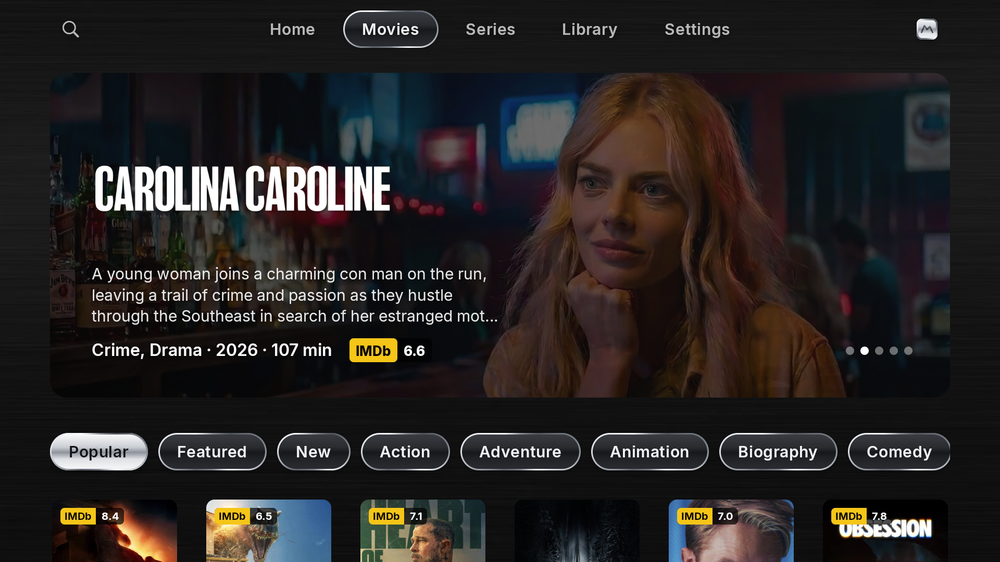
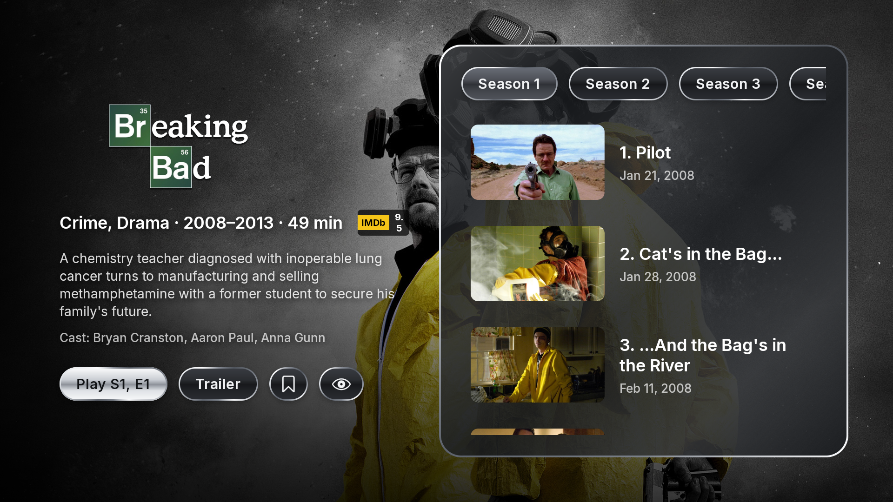
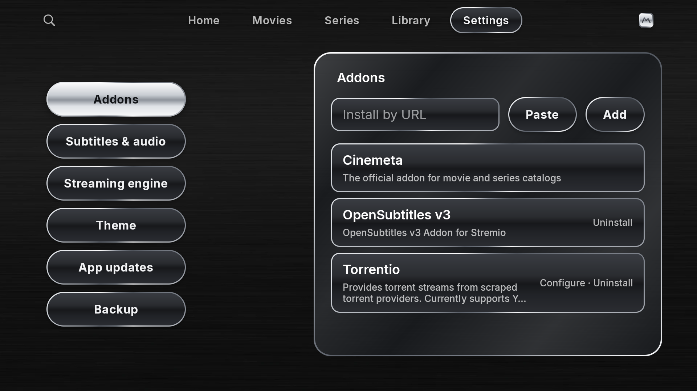

# Mach TV

An Android TV media center built on [stremio-core](https://github.com/Stremio/stremio-core), with on-device torrent playback through [stream-server](https://github.com/stremio-native/stream-server).

It uses Stremio addons without a Stremio account, and its library and settings stay on the TV. A fresh install has Cinemeta and OpenSubtitles v3; other addons install by URL in Settings → Addons. Settings → Backup exports and imports the addons and the library.

## Screenshots









## Layout

- `app/`: the TV interface, in Compose, and the Media3 player.
- `core/`: an Android library wrapping stremio-core and the streaming engine.
- `ffmpeg/`: Media3's FFmpeg audio extension.
- `native/machtv-core/`: the Rust bridge to stremio-core.
- `native/machtv-engine/`: stream-server as its own native library.
- `native/stream-server/`: stream-server's `enginefs` and `libtorrent-sys` crates, patched to save and reuse libtorrent resume data.

## Build

Requires:
- Linux x86-64, because the FFmpeg build uses the NDK's Linux toolchain
- JDK 21
- the Android SDK with platform 37 and NDK 28.2.13676358
- Rust with the `aarch64-linux-android` and `armv7-linux-androideabi` targets
- [cargo-ndk](https://github.com/bbqsrc/cargo-ndk)
- CMake, Ninja, pkg-config, git and make

`local.properties` sets `sdk.dir` to the Android SDK and `vcpkg.dir` to vcpkg.

stream-server's libtorrent, Boost and OpenSSL are built with [vcpkg](https://github.com/microsoft/vcpkg) at commit `84bab45d415d22042bd0b9081aea57f362da3f35`. Clone vcpkg, check out that commit, run `./bootstrap-vcpkg.sh -disableMetrics`, and set its location as `vcpkg.dir`. The first build compiles them for both ABIs.

The first build also clones FFmpeg `n6.0.1` into `ffmpeg/src/main/jni/ffmpeg` and builds its TrueHD, MLP, DTS, AC3 and E-AC3 decoders for both ABIs.

```bash
./gradlew :app:assembleDebug
```

The APK is `app/build/outputs/apk/debug/app-debug.apk`. `./gradlew :app:installDebug` installs it on the device adb is connected to.

## Test

On the host:

```bash
cargo test --manifest-path native/machtv-core/Cargo.toml
./gradlew :core:testDebugUnitTest :app:testDebugUnitTest
```

On an Android TV device over adb, the core library:

```bash
./gradlew :core:installDebugAndroidTest
TESTS=io.github.machtvapps.machtv.core.CoreBridgeTest
RUNNER=io.github.machtvapps.machtv.core.test/androidx.test.runner.AndroidJUnitRunner
adb shell am instrument -w -e class "$TESTS#torrentioInstallsByUrl,$TESTS#cinemetaPopularMoviesLoads,$TESTS#installTorrentioBeforeRestart" "$RUNNER"
adb shell am instrument -w -e class "$TESTS#addonsSurviveRestart" "$RUNNER"
adb shell am instrument -w -e class io.github.machtvapps.machtv.core.EngineTest "$RUNNER"
```

The core tests need network access. The second run starts a new process and checks what the first stored. The engine test plays a Torrentio result for Big Buck Bunny through the on-device engine, which joins the torrent swarm. It needs port 11470 free, so leave Mach TV's Player and Streaming engine page first.

The audio decoders:

```bash
./gradlew :app:installDebug :app:installDebugAndroidTest
adb shell am instrument -w -e class io.github.machtvapps.machtv.FfmpegAudioTest io.github.machtvapps.machtv.test/androidx.test.runner.AndroidJUnitRunner
```

`FfmpegAudioTest` plays 3-second 5.1 TrueHD, DTS, AC3 and E-AC3 clips through the app's renderers and checks which decoder, if any, plays each.
